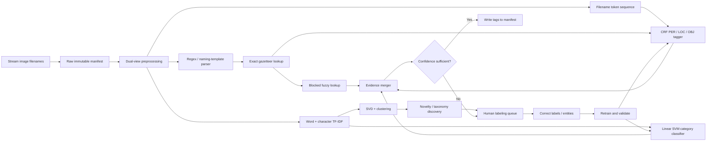

# Extraction and File Categorization from Windows Image Filenames

## Executive summary

The problem is best treated as **two related but distinct NLP tasks** operating on unusually short, noisy text:

1. **Entity extraction:** identify spans corresponding to people, places, and domain-defined named objects/products, for example `John-Smith`, `Vancouver`, and `Canon-EOS-R5`.
2. **File categorization:** assign the whole filename to one or more useful categories, for example `family`, `travel`, `concert`, `camera`, `screenshot`, or `unknown`.

These tasks should not be collapsed into one model. A filename such as `2025-03-11_John-Smith@Vancouver_Canon-EOS-R5_final-v2.jpg` contains strong local clues for entity extraction but may still require a separate decision about the file's overall category.

The central constraint is severe: **only the filename/title text is available**. There is no image content, EXIF, directory context, OCR, geolocation, or other metadata to disambiguate `Jordan` as a person versus a place, or determine what `DSC_1042` depicts. Consequently, there is an irreducible ambiguity ceiling. The production system should therefore support an explicit `UNKNOWN`/abstain state rather than forcing every filename into an entity or category.

For this setting, the highest-value practical architecture is **hybrid rather than purely ML**:

> **Unicode-preserving preprocessing → regex/noise parsing → exact and fuzzy gazetteers → CRF entity tagger → word + character TF-IDF → linear SVM file classifier → optional clustering for discovery → confidence gate → human review.**

This recommendation follows from several properties of filenames:

- **Character n-grams are unusually valuable.** They survive inconsistent separators, capitalization, truncation, spelling variants, and tokens such as `EOS-R5`, `McCartney`, or `Vancouver2024`. Scikit-learn supports both character and `char_wb` n-gram analyzers, as well as word n-grams, document-frequency filtering, sublinear TF, and sparse TF-IDF representations. citeturn9view0turn9view1turn9view2
- **TF-IDF + LinearSVC should be the first supervised categorization model.** `LinearSVC` directly accepts sparse features and is explicitly designed to scale better than kernel `SVC` as sample counts grow. citeturn9view3
- **A linear-chain CRF is the strongest first NER model** when several hundred to several thousand filenames can be span-labeled. It naturally models adjacent BIO/BILOU tags while admitting arbitrary lexical, orthographic, regex, and gazetteer features. CRFs are established structured-prediction models, and classical NER benchmarks have long evaluated entity extraction as sequence labeling. citeturn17search13turn5view1
- **BiLSTM-CRF is the sensible neural upgrade**, not the starting point. Neural NER work by Lample et al. and Ma & Hovy demonstrated the usefulness of bidirectional recurrent representations, character-level modeling, and CRF decoding without requiring an LLM. However, those results were obtained on normal-language NER corpora, not filenames; a local filename benchmark remains decisive. citeturn11view0turn11view1
- **Gazetteers remain highly valuable.** GeoNames, for example, publishes downloadable geographic databases assembled from many sources, making it suitable as one place-name signal. A gazetteer hit should be treated as evidence, not proof: `Victoria`, `Jordan`, `Paris`, and similar strings are intrinsically ambiguous. citeturn7view1
- **Fuzzy matching should be second-pass, not universal.** RapidFuzz provides normalized edit-derived ratios plus partial, token-set, and token-sort similarities. These are useful for `Vancouvr` → `Vancouver` or reordered aliases, but unconstrained fuzzy search over a huge name dictionary will create false positives and unnecessary \(O(NG)\)-style comparison work. citeturn7view0
- **Clustering is most useful for discovery and labeling assistance, not as the final production categorizer.** MiniBatchKMeans is appropriate for large corpora; DBSCAN is useful for dense families and outliers; hierarchical clustering helps discover taxonomy on smaller samples. Scikit-learn documents the different scaling/geometry assumptions of these approaches and notes that MiniBatchKMeans trades a modest amount of clustering quality for substantially faster fitting. citeturn10view0turn10view1turn10view2turn10view3
- **LDA is a weak fit for individual filenames** because its document-level topic-mixture model has very little word-count evidence when a "document" may contain only three to eight useful tokens. That is a problem-specific inference from LDA's generative document/topic formulation, not a claim that LDA is generally weak. citeturn5view0
- **BERTopic can be made genuinely non-LLM in this pipeline.** The original BERTopic formulation used pretrained transformer embeddings before clustering and class-based TF-IDF, but current BERTopic documentation permits non-transformer embeddings, including static embeddings and a scikit-learn TF-IDF + TruncatedSVD pipeline. For a strict non-LLM system, use the latter rather than a sentence-transformer. citeturn13academia40turn5view3

A practical production recommendation is therefore:

| Component | Recommended first choice | Why |
| --- | --- | --- |
| Filename parsing | Unicode normalization + regex + separator-aware tokenization | Deterministic, inspectable, extremely cheap |
| Place candidates | Exact GeoNames/local aliases, then restricted fuzzy matching | High precision with broad coverage |
| Person/object candidates | Domain-specific dictionaries + CRF | Generic dictionaries alone are too ambiguous |
| NER | **Linear-chain CRF** | Strong balance of accuracy, CPU speed, explainability, and small-data behavior |
| File categorization | **word TF-IDF + char TF-IDF + LinearSVC** | Excellent short/noisy-text baseline; sparse and scalable |
| Neural upgrade | BiLSTM-CRF | Useful once enough filename-specific span labels exist |
| Strictly optional encoder | Frozen transformer encoder | Boundary case only; exclude if "no language models at all" is the requirement |
| Unsupervised discovery | SVD + MiniBatchKMeans; DBSCAN for near-duplicate/dense groups | Helps find latent naming conventions and labeling strata |
| Topic modeling | LDA only as a baseline; non-LLM BERTopic variant for exploration | Secondary to direct lexical clustering |
| Deployment | Manifest-first, confidence-gated, dry-run | Avoids dangerous automatic file moves |

The qualitative recommendations above are **not expected accuracy percentages**. Accuracy cannot responsibly be predicted without knowing the directory's naming conventions, category definitions, languages, duplication rate, and label distribution. Evaluation should be performed on a held-out, near-duplicate-grouped sample of the actual filenames.

## Problem model, filename preprocessing, and deterministic extraction

The following assumptions are intentionally conservative:

| Unknown | Working assumption |
| --- | --- |
| Directory size | Unknown; architecture must work from thousands to millions of filenames |
| Filename language | Unknown and potentially multilingual |
| Image formats | Multiple formats may be present; extension is used for enumeration, not semantic prediction unless explicitly permitted |
| Folder names | Not available as model input |
| Image pixels / OCR | Not available |
| EXIF / timestamps | Not available |
| Category taxonomy | Must be supplied or discovered from a sample |
| Person/place/object dictionaries | May be incomplete |
| Entity labels | `PER`, `LOC`, and a domain-defined `OBJ`; `OBJ` means a named product/artifact/thing rather than every generic noun |
| Filename duplication | Unknown; assume resized/copy/final/version variants are common enough to guard against evaluation leakage |

**The first architectural principle is to preserve two or three filename views rather than destructively "cleaning" one string.**

For

```text
IMG_2025-03-11_John-Smith@Vancouver_Canon-EOS-R5_final-v2_0042.jpg
```

retain approximately:

```text
RAW:
IMG_2025-03-11_John-Smith@Vancouver_Canon-EOS-R5_final-v2_0042

PARSED:
IMG | 2025-03-11 | John-Smith | Vancouver | Canon-EOS-R5 | final-v2 | 0042

CLASSIFICATION VIEW:
<DATE> John Smith Vancouver Canon EOS R5

NER TOKENS:
IMG
2025-03-11
John
-
Smith
@
Vancouver
Canon
-
EOS
-
R5
final
-
v2
0042
```

The raw view prevents normalization from destroying useful evidence. The classification view suppresses boilerplate. The NER view preserves boundaries and punctuation so a sequence tagger can learn that `John-Smith` and `EOS-R5` have different structural roles.

**Unicode and case.** Preserve the original Unicode text and normalize canonically, preferably NFC for the canonical representation. A second comparison/ML representation may use case folding or lowercasing. Do not discard accents from the canonical string: `José`, `Søren`, `Łódź`, and `Québec` should remain recoverable. Scikit-learn's TF-IDF implementation can lowercase and can perform Unicode accent normalization, but those transformations should be regarded as optional feature-channel transformations rather than irreversible filename cleanup. citeturn9view1

**Tokenization.** Filename tokenization should deliberately differ from generic prose tokenization. Treat `_`, repeated spaces, brackets, and many `@`/`+` occurrences as likely boundaries, while recognizing that hyphens, apostrophes, periods, `#`, and mixed alphanumeric strings can belong inside names or products. Scikit-learn's default word token pattern treats punctuation as separators, which is one reason a custom token pattern plus character n-grams is preferable here. citeturn9view0

**Noise/metadata detection should precede language processing.** Useful deterministic classes include:

- dates such as `2025-03-11`, `20250311`, `11-Mar-2025`;
- camera/file counters such as `IMG_0042`, `DSC12345`, `PXL_20250311`;
- version/edit suffixes such as `final`, `final2`, `edited`, `copy`, `(1)`, `v3`;
- dimensions such as `1920x1080`;
- UUIDs, hashes, export identifiers, and long serial-like fields;
- application boilerplate such as `Screenshot`, `WhatsApp Image`, or locally observed export prefixes.

Do **not** delete these immediately. Parse them into side features such as `has_date`, `has_sequence`, `has_version`, and only remove or replace them in the semantic classification channel.

**Stopwords should be corpus-specific.** Generic English stopword lists are risky because filenames are extremely short. Scikit-learn itself documents known issues with its built-in English stopword option and notes that `max_df` can be used to identify corpus-specific high-frequency terms. citeturn9view0 A directory-specific list such as `{img, dsc, photo, image, screenshot, copy, edited, export}` is usually more defensible, but every candidate stopword should first be checked against category usefulness.

**Stemming and lemmatization should be conservative.** For NER, I recommend **neither** as the canonical representation: changing a proper name or product identifier can remove the very signal being sought. For whole-file categorization, lemmatization can be A/B tested as an auxiliary feature channel if the language is known, but word/character n-grams often make it unnecessary. Aggressive stemming should be near the bottom of the experiment list.

**Regex parsing example:**

```python
from __future__ import annotations

import re
import unicodedata
from dataclasses import dataclass
from pathlib import Path


ISO_DATE = re.compile(
    r"(?<!\d)(?:19|20)\d{2}[-_.]"
    r"(?:0?[1-9]|1[0-2])[-_.]"
    r"(?:0?[1-9]|[12]\d|3[01])(?!\d)"
)

COMPACT_DATE = re.compile(
    r"(?<!\d)(?:19|20)\d{2}(?:0[1-9]|1[0-2])"
    r"(?:0[1-9]|[12]\d|3[01])(?!\d)"
)

RESOLUTION = re.compile(r"(?i)(?<!\d)\d{3,5}x\d{3,5}(?!\d)")
CAMERA_COUNTER = re.compile(r"(?i)\b(?:img|dsc|dscf|pxl)[-_ ]?\d{3,}\b")
TRAILING_COUNTER = re.compile(r"(?<!\d)\d{3,7}$")
VERSION = re.compile(r"(?i)\b(?:final\d*|edited|edit|copy|v\d+)\b")

NOISE_WORDS = {
    "img", "image", "photo", "picture", "screenshot",
    "copy", "edited", "edit", "export",
}


@dataclass(frozen=True)
class FilenameViews:
    raw: str
    parsed: str
    classification: str
    has_date: bool
    has_counter: bool
    has_resolution: bool
    has_version: bool


def filename_views(filename: str) -> FilenameViews:
    stem = Path(filename).stem
    raw = unicodedata.normalize("NFC", stem)

    has_date = bool(ISO_DATE.search(raw) or COMPACT_DATE.search(raw))
    has_counter = bool(
        CAMERA_COUNTER.search(raw) or TRAILING_COUNTER.search(raw)
    )
    has_resolution = bool(RESOLUTION.search(raw))
    has_version = bool(VERSION.search(raw))

    # Parsing representation: obvious separators become spaces.
    # Leave hyphens intact initially; they may belong to names/products.
    parsed = re.sub(r"[_@\[\]{}()]+", " ", raw)
    parsed = re.sub(r"\s+", " ", parsed).strip()

    semantic = ISO_DATE.sub(" <DATE> ", parsed)
    semantic = COMPACT_DATE.sub(" <DATE> ", semantic)
    semantic = RESOLUTION.sub(" <RESOLUTION> ", semantic)
    semantic = CAMERA_COUNTER.sub(" ", semantic)
    semantic = VERSION.sub(" ", semantic)

    words = [
        w for w in re.split(r"\s+", semantic)
        if w.casefold() not in NOISE_WORDS
    ]
    classification = re.sub(r"\s+", " ", " ".join(words)).strip()

    return FilenameViews(
        raw=raw,
        parsed=parsed,
        classification=classification,
        has_date=has_date,
        has_counter=has_counter,
        has_resolution=has_resolution,
        has_version=has_version,
    )
```

The deterministic layer should then construct **candidate spans**, not immediately assert entities. Candidate generation can combine:

\[
\text{candidate score}(s,e)=
w_gG+w_cC+w_oO+w_rR+w_fF
\]

where \(G\) is gazetteer evidence, \(C\) capitalization/shape evidence, \(O\) orthographic evidence such as hyphens or mixed alphanumerics, \(R\) regex/template evidence, and \(F\) frequency or corpus evidence. The weights may be hand-tuned initially and later learned.

For places, exact matching against GeoNames or a smaller geographically relevant subset is a strong high-precision signal. GeoNames publishes daily downloadable extracts and aggregates more than one hundred data sources, although its own documentation also emphasizes that the data carry no warranty; consequently, snapshot and validate the subset used in production. citeturn7view1

Person dictionaries are different. A generic first-name database can suggest that `Maria` is *name-like*, but it does not establish that it identifies a person in a particular filename. A curated set of known people, aliases, artists, contacts, or project participants is much more useful. Likewise, `OBJ` should use domain dictionaries where possible—camera models, cars, aircraft, artworks, products, buildings, collections, and so forth.

Fuzzy matching is best layered on top of this candidate process. RapidFuzz defines normalized string-similarity methods including full ratio, partial-ratio, token-set and token-sort comparison. citeturn7view0 For example:

```python
from rapidfuzz import fuzz, process


def fuzzy_gazetteer_match(
    candidate: str,
    aliases: list[str],
    cutoff: float = 90.0,
) -> tuple[str, float] | None:
    """
    High-precision second-pass matching.
    Tune cutoff on a labeled validation set.
    """
    result = process.extractOne(
        candidate,
        aliases,
        scorer=fuzz.WRatio,
        score_cutoff=cutoff,
    )
    if result is None:
        return None

    matched_name, score, _index = result
    return matched_name, float(score)


places = ["Vancouver", "North Vancouver", "Victoria", "Montréal"]

print(fuzzy_gazetteer_match("Vancouvr", places))
# Typical intent: ("Vancouver", high_score)
```

At scale, do **not** compare every candidate to every gazetteer entry. First block candidates by inexpensive keys such as first character, token count, length band, phonetic key where appropriate, or shared character trigrams; run edit-distance scoring only within the resulting candidate bucket. Exact hash lookup should always precede fuzzy lookup.

Ambiguity must remain explicit:

```text
Jordan      -> PER? LOC?
Victoria    -> PER? LOC?
Amazon      -> ORG? LOC? PRODUCT?
Mustang     -> OBJ/car? animal? place?
Paris       -> LOC? PER?
```

A useful hybrid system records multiple hypotheses, for example:

```json
{
  "span": "Jordan",
  "candidates": [
    {"type": "PER", "score": 0.69},
    {"type": "LOC", "score": 0.65}
  ],
  "status": "review"
}
```

rather than converting weak lexical evidence into a false fact.

## Supervised classification and filename-tailored NER

For whole-file categorization, a **sparse lexical model should be the reference baseline against which every more complicated approach must win**.

```latex
TF-IDF represents term \(t\) in document/filename \(d\) approximately as

\[
x_{d,t}=\operatorname{tf}(t,d)\operatorname{idf}(t)
\]

with the smoothed scikit-learn convention

\[
\operatorname{idf}(t)
=

\log\left(\frac{1+N}{1+\operatorname{df}(t)}\right)+1,
\]

followed normally by vector normalization. Scikit-learn also supports sublinear term frequency \(1+\log(tf)\), which is a reasonable default experiment here. citeturn9view2

The feature space should concatenate:

\[
\mathbf{x}
=

[
\mathbf{x}*{word(1,2)};
\mathbf{x}*{char(3,5)};
\mathbf{x}*{shape};
\mathbf{x}*{rule}
]
\]

where word unigrams/bigrams capture meaningful phrases, character 3–5-grams capture misspellings and formatting variation, and optional handcrafted features describe dates, counters, capitalization, token count, product-like alphanumerics, and gazetteer hits.

A binary linear SVM conceptually solves

\[
\min_{\mathbf w,b}
\frac12\|\mathbf w\|_2^2
+
C\sum_i
\max\left(0,\,1-y_i(\mathbf w^\top\mathbf x_i+b)\right),
\]
```

or a squared-hinge variant. Multiclass prediction can be constructed one-vs-rest. `LinearSVC` works directly with sparse matrices and is explicitly documented as scaling better than linear-kernel `SVC` to large sample counts. citeturn9view3

A strong baseline implementation is:

```python
from sklearn.pipeline import FeatureUnion, Pipeline
from sklearn.feature_extraction.text import TfidfVectorizer
from sklearn.svm import LinearSVC


word_tfidf = TfidfVectorizer(
    lowercase=True,
    ngram_range=(1, 2),
    min_df=2,
    max_df=0.95,
    sublinear_tf=True,
    token_pattern=r"(?u)\b[\w][\w.+#'-]*\b",
)

char_tfidf = TfidfVectorizer(
    lowercase=True,
    analyzer="char_wb",
    ngram_range=(3, 5),
    min_df=2,
    sublinear_tf=True,
)

model = Pipeline([
    (
        "features",
        FeatureUnion([
            ("word", word_tfidf),
            ("char", char_tfidf),
        ]),
    ),
    (
        "classifier",
        LinearSVC(
            C=1.0,
            class_weight="balanced",  # remove if classes are already balanced
        ),
    ),
])

# train_names = preprocessed filename strings
# train_labels = category labels
model.fit(train_names, train_labels)

predicted = model.predict([
    "John Smith Vancouver Canon EOS R5"
])
```

Scikit-learn explicitly supports the word/character analyzers and n-gram ranges used here. citeturn9view0turn9view1

Recommended initial SVM search space:

| Hyperparameter | Initial values |
| --- | --- |
| Word n-grams | `(1,1)`, `(1,2)` |
| Character analyzer | `char_wb`; also test raw `char` |
| Character n-grams | `(3,5)`, `(2,6)` |
| `min_df` | `1` for small corpora; `2`, `3`, `5` for larger ones |
| `max_df` | `0.95`, `0.99` |
| `sublinear_tf` | `True` |
| `C` | `0.25, 0.5, 1, 2, 4` |
| Class weighting | none vs. `balanced` |
| Category policy | single-label first; multilabel only where taxonomy genuinely overlaps |

These are starting points to tune locally, not universal optima.

**Naive Bayes** should be retained as a speed/sanity baseline. MultinomialNB is specifically intended for multinomial/discrete features such as word counts, and scikit-learn notes that TF-IDF values can also work in practice. citeturn19view2 Its assumptions are crude, but its training cost is low and it exposes whether the problem can already be solved by very simple token statistics.

**Random Forest** is valid but not my first choice for raw TF-IDF. Random forests average multiple tree classifiers to improve predictive accuracy and control overfitting. citeturn12search0 For filename work I would use them mainly on a compact engineered feature vector—length, token count, regex flags, dictionary counts, character-shape statistics, perhaps SVD components—rather than asking trees to navigate hundreds of thousands of sparse n-gram coordinates. That latter preference is an engineering judgment that should be verified on the local corpus.

For entity extraction, formulate filename NER as BIO/BILOU sequence tagging. For example:

```text
John       B-PER
Smith      I-PER
Vancouver  B-LOC
Canon      B-OBJ
EOS        I-OBJ
R5         I-OBJ
```

A linear-chain CRF models

```latex
\[
P(\mathbf y\mid\mathbf x)
=

\frac{1}{Z(\mathbf x)}
\exp
\left[
\sum_t\sum_k
\lambda_k
f_k(y_{t-1},y_t,\mathbf x,t)
\right],
\]
```

where the feature functions can directly represent facts such as:

```text
token.lower == "vancouver"
token has uppercase initial
token is all uppercase
token contains digits
token contains hyphen
token prefix/suffix
token matches DATE
token matches sequence counter
token is in place gazetteer
token is in person alias dictionary
token is in product dictionary
previous/next token shape
```

This ability to combine arbitrary observations with adjacent-label dependencies is exactly why CRFs are well matched to this task. CRFs are discriminative structured prediction models with broad NLP usage. citeturn17search13

A compact implementation using the scikit-learn-compatible CRFsuite wrapper—the project documents `sklearn_crfsuite.CRF` as a thin wrapper around CRFsuite—is: citeturn15search17

```python
import sklearn_crfsuite


def token_features(tokens: list[str], i: int,
                   people: set[str],
                   places: set[str],
                   objects: set[str]) -> dict:
    t = tokens[i]
    low = t.casefold()

    feats = {
        "bias": 1.0,
        "token.lower": low,
        "token[-2:]": low[-2:],
        "token[-3:]": low[-3:],
        "token[:2]": low[:2],
        "token[:3]": low[:3],
        "isupper": t.isupper(),
        "istitle": t.istitle(),
        "isdigit": t.isdigit(),
        "has_digit": any(c.isdigit() for c in t),
        "has_hyphen": "-" in t,
        "length": len(t),
        "in_people": low in people,
        "in_places": low in places,
        "in_objects": low in objects,
    }

    if i > 0:
        p = tokens[i - 1]
        feats.update({
            "-1:lower": p.casefold(),
            "-1:istitle": p.istitle(),
            "-1:isupper": p.isupper(),
        })
    else:
        feats["BOS"] = True

    if i + 1 < len(tokens):
        n = tokens[i + 1]
        feats.update({
            "+1:lower": n.casefold(),
            "+1:istitle": n.istitle(),
            "+1:isupper": n.isupper(),
        })
    else:
        feats["EOS"] = True

    return feats


def sequence_features(tokens, people, places, objects):
    return [
        token_features(tokens, i, people, places, objects)
        for i in range(len(tokens))
    ]


crf = sklearn_crfsuite.CRF(
    algorithm="lbfgs",
    c1=0.05,                  # L1 regularization
    c2=0.10,                  # L2 regularization
    max_iterations=100,
    all_possible_transitions=True,
)

# X_train: list[list[dict]]
# y_train: list[list[str]], e.g. ["B-PER", "I-PER", "B-LOC", ...]
crf.fit(X_train, y_train)
predicted_tags = crf.predict(X_test)
```

Search `c1` over roughly `{0, .01, .05, .1}` and `c2` over `{.01, .05, .1, .5, 1}` rather than taking the illustrative values as fixed.

An **HMM** provides a useful historical/generative comparison:

```latex
\[
P(\mathbf x,\mathbf y)
=

P(y_1)
P(x_1\mid y_1)
\prod_{t=2}^{T}
P(y_t\mid y_{t-1})
P(x_t\mid y_t).
\]
```

Its attraction is simplicity and efficient dynamic programming; its weakness here is that filename tokens have many overlapping observations—capitalization, character shape, dictionary memberships, neighboring punctuation—so the richer conditional feature treatment of a CRF is generally more natural. Rabiner's classic HMM tutorial formalized the model family and its sequence-decoding setting. citeturn14view2turn17search0

A **BiLSTM-CRF** replaces handcrafted emission scoring with learned context-sensitive features. At token \(t\),

```latex
\[
\mathbf h_t=
[
\overrightarrow{\operatorname{LSTM}}(\mathbf e_{1:t});
\overleftarrow{\operatorname{LSTM}}(\mathbf e_{T:t})
],
\]
```

and a linear layer produces emission scores \(s_t(y)\), while the CRF layer adds learned transition scores \(A_{y_{t-1},y_t}\). Decoding seeks

```latex
\[
\hat{\mathbf y}
=

\arg\max_{\mathbf y}
\left(
\sum_t s_t(y_t)+
\sum_t A_{y_{t-1},y_t}
\right).
\]
```

Lample et al. demonstrated neural NER architectures combining character-derived representations and recurrent sequence modeling, while Ma & Hovy combined character CNNs, bidirectional LSTMs, and CRF decoding. These are non-generative neural NER approaches and do not require an LLM at inference. citeturn11view0turn11view1

For filenames, character representations are particularly attractive because they can learn patterns such as `Mc...`, capitalization, model-number morphology, suffixes, and punctuation. Nevertheless, I would not deploy BiLSTM-CRF until the CRF baseline has been evaluated: filenames are short enough that explicit lexical/gazetteer features can be extremely competitive with far less operational complexity.

A reasonable BiLSTM-CRF starting configuration, if enough labeled filenames are available, is 100-dimensional token embeddings, 25–50-dimensional character embeddings, roughly 128 hidden units per LSTM direction, dropout 0.3–0.5, Adam near \(10^{-3}\), gradient clipping, and early stopping on entity-level validation F1. Those values are engineering starting points requiring tuning.

**Frozen transformer encoders are a boundary case.** BERT itself is explicitly a pretrained bidirectional Transformer language-representation model. citeturn14view0 Thus:

- Under a strict interpretation of “no language models,” exclude BERT/MiniLM-style encoders entirely.
- Under the user's stated allowance for “transformer encoders used as feature extractors,” a **frozen** small encoder can generate filename vectors for an SVM or clusterer without generation or LLM prompting.
- It should remain an optional experiment, because lexical TF-IDF is much lighter and may be equally or more effective for highly idiosyncratic filenames.

The comparative picture is:

| Method | Main task | Expected suitability here* | Runtime | Complexity | Labeled data | Noisy-title robustness |
| --- | --- | ---: | ---: | ---: | ---: | ---: |
| Regex/templates | Parsing, high-precision extraction | Medium; very high on known formats | **Very fast** | Low | None | Medium; brittle to unseen templates |
| Exact gazetteer | PER/LOC/OBJ candidates | High precision if dictionary is well targeted | **Very fast** | Low–medium | None | Low–medium |
| Fuzzy gazetteer | Misspellings/aliases | Medium–high after good blocking | Medium | Medium | Validation set desirable | **High** for small spelling errors |
| TF-IDF + LinearSVC | File category | **High-value baseline** | **Fast** | Low–medium | Moderate | **High** with char n-grams |
| Multinomial NB | File category | Medium baseline | **Very fast** | Low | Moderate | Medium |
| Random Forest | Category from engineered features | Medium | Medium | Medium | Moderate | Medium |
| HMM | Entity spans | Low–medium relative to CRF | Fast | Medium | Moderate | Medium |
| CRF | Entity spans | **High-value baseline** | Fast CPU | Medium | Moderate | **High** with char/shape/gazetteer features |
| BiLSTM-CRF | Entity spans | Potentially high | Medium | High | Moderate–high | **High** |
| Frozen transformer features | Category/clustering/NER features | Potentially high but optional | Slow–medium | High | Low–moderate downstream | High |
| MiniBatchKMeans | Discovery/grouping | Medium | **Fast/scalable** | Low–medium | None | Medium–high with char features |
| Agglomerative | Taxonomy discovery | Medium | Slow as corpus grows | Medium | None | Medium |
| DBSCAN | Dense families/outliers | Medium for suitable geometry | Medium | Medium | None | High for duplicate-like groups |
| LDA | Topics | Low–medium for ultrashort titles | Medium | Medium | None | Low–medium |
| Non-LLM BERTopic variant | Exploratory topics | Medium, corpus-dependent | Medium–slow | High | None | Medium–high |

\*“Suitability” is an analytical expectation, **not a measured accuracy claim**. The real ranking must be established on this particular directory.

## Clustering, topic models, evaluation, and human feedback

Unsupervised methods solve a different problem from supervised categorization. If the desired categories already exist, supervised learning usually gives a more directly optimizable objective. Clustering is valuable when the taxonomy is unclear, when the directory contains previously unknown naming templates, or when one wants to select diverse examples for human labeling.

For L2-normalized feature vectors, k-means seeks centers \(\boldsymbol\mu_k\) minimizing

```latex
\[
J=
\sum_{i=1}^{N}
\min_k
\|\mathbf x_i-\boldsymbol\mu_k\|_2^2.
\]
```

Scikit-learn documents this within-cluster sum-of-squares objective, notes that KMeans assumes relatively convex/isotropic geometry, and provides MiniBatchKMeans as a faster approximation for large corpora. citeturn10view1 In this filename setting, I recommend reducing a combined word+character TF-IDF matrix to roughly 50–150 SVD dimensions before exploratory clustering.

```python
from sklearn.pipeline import FeatureUnion
from sklearn.feature_extraction.text import TfidfVectorizer
from sklearn.decomposition import TruncatedSVD
from sklearn.preprocessing import Normalizer
from sklearn.cluster import MiniBatchKMeans
from sklearn.metrics import silhouette_score


features = FeatureUnion([
    (
        "word",
        TfidfVectorizer(
            ngram_range=(1, 2),
            min_df=2,
            sublinear_tf=True,
        ),
    ),
    (
        "char",
        TfidfVectorizer(
            analyzer="char_wb",
            ngram_range=(3, 5),
            min_df=2,
            sublinear_tf=True,
        ),
    ),
])

X = features.fit_transform(filenames)

dims = min(100, max(2, X.shape[1] - 1))
svd = TruncatedSVD(n_components=dims, random_state=42)
Z = svd.fit_transform(X)
Z = Normalizer(copy=False).fit_transform(Z)

clusterer = MiniBatchKMeans(
    n_clusters=30,      # sweep rather than hard-code in production
    batch_size=4096,
    n_init="auto",
    random_state=42,
)

labels = clusterer.fit_predict(Z)

sil = silhouette_score(
    Z,
    labels,
    metric="cosine",
    sample_size=min(10_000, len(filenames)),
    random_state=42,
)
print("silhouette:", sil)
```

Do not choose \(k\) using silhouette alone. Examine several \(k\) values and inspect representative filenames, because a mathematically compact clustering may split files along unhelpful dimensions such as camera prefix, year, or filename-generation application.

**Hierarchical/agglomerative clustering** is useful on a sample when the category hierarchy is itself unknown. Ward, single, average, and complete linkage are supported; average/complete linkage can work with non-Euclidean metrics, whereas single linkage is sensitive to chaining/noise. citeturn10view3 Its main advantage here is interpretability: a dendrogram-like hierarchy can reveal that `travel → Canada → Vancouver` and `camera → Canon → EOS-R5` might make more sense than one flat partition.

**DBSCAN** is attractive for two narrower jobs: finding dense naming families and isolating noise/outliers. It does not require choosing the number of clusters and can recover non-convex cluster shapes; its behavior is controlled mainly by `eps` and `min_samples`. citeturn10view2 On filename vectors, tune it only after dimensionality reduction or after constructing a meaningful cosine/edit-distance neighborhood representation. It is particularly interesting for variant families such as:

```text
John_Vancouver_001
John_Vancouver_001_copy
John-Vancouver-001-edited
John Vancouver 001 (1)
```

**LDA** models documents through latent topic mixtures and topics through word distributions. citeturn5view0 A filename usually contains too few semantically meaningful tokens to estimate an informative per-document topic mixture, so I would include LDA only as an inexpensive benchmark. It becomes more sensible if filenames are aggregated first—for example, by naming template or precluster—creating longer pseudo-documents.

**BERTopic without LLMs requires an explicit configuration choice.** The published BERTopic procedure uses pretrained transformer document embeddings, clustering, and class-based TF-IDF. citeturn13academia40 Its current documentation, however, permits static word embeddings as well as a scikit-learn embedding pipeline built from TF-IDF and TruncatedSVD. citeturn5view3 Thus a strict non-LLM variant can use:

```text
TF-IDF → TruncatedSVD → clustering → c-TF-IDF topic descriptors
```

rather than Sentence-BERT. This is useful for exploration, but it is essentially a sophisticated clustering/topic-labeling layer, not a replacement for a labeled production classifier.

**Evaluation must mirror the actual outputs.**

For exact entity extraction, define a true positive only when **both the span and entity type are correct**. Then

```latex
\[
P=\frac{TP}{TP+FP},
\qquad
R=\frac{TP}{TP+FN},
\]
```

and

```latex
\[
F_1=\frac{2PR}{P+R}.
\]
```

Report entity-level precision, recall, and F1 overall and separately for `PER`, `LOC`, and `OBJ`. This is more meaningful than token accuracy because a system that marks only one token of `North Vancouver` has not really extracted the entity. CoNLL-style NER evaluation established span/entity-oriented evaluation as a standard NER setting. citeturn5view1

For file categorization, report at minimum **macro-F1** and the confusion matrix. Macro-F1 prevents large classes from hiding failure on smaller ones. If categories become multilabel, report per-class and micro/macro precision/recall/F1 rather than simple top-1 accuracy.

For clustering, purity is

```latex
\[
\operatorname{purity}(\Omega,C)
=

\frac{1}{N}
\sum_k
\max_j
|\omega_k\cap c_j|,
\]
```

where \(\omega_k\) is cluster \(k\) and \(c_j\) is a gold class. Purity is intuitive but can be gamed by producing many tiny clusters; it should therefore never be the sole cluster metric.

The silhouette value for sample \(i\) is

```latex
\[
s(i)=
\frac{b(i)-a(i)}
{\max(a(i),b(i))},
\]
```

where \(a(i)\) is mean within-cluster distance and \(b(i)\) is mean distance to the nearest other cluster. It ranges from \(-1\) to \(1\); values near zero suggest overlap. Scikit-learn documents exactly this formulation and supports sampling when full pairwise computation would be excessive. citeturn19view1

More important than the formulas is **evaluation split design**. Do not randomly place near-identical filenames in train and test:

```text
Paris_John_001.jpg
Paris_John_001_copy.jpg
Paris_John_001_edited.jpg
Paris_John_001_small.jpg
```

If three variants train the model and the fourth appears in the test set, reported performance measures memorization of naming families rather than generalization. Normalize obvious copy/version fields, identify near-duplicate families, and split those families as groups. A second “future/drift” test set drawn from later or newly imported filenames is even more informative operationally.

A useful scorecard is:

| Layer | Primary metrics | Additional diagnostics |
| --- | --- | --- |
| Regex/gazetteer NER | Entity P/R/F1 | Coverage; ambiguity rate; per-rule FP rate |
| CRF/BiLSTM-CRF | Exact span+type P/R/F1 | Boundary F1; per-type F1; OOV-name recall |
| File classifier | Macro-F1 | Per-class P/R; confusion; abstention coverage |
| Fuzzy matching | P/R at thresholds | Precision-vs-cutoff curve |
| Clustering | Silhouette, purity | Cluster size distribution; inspected coherence |
| Production | files/sec | peak RAM, exceptions, review rate, model drift |

**Human-in-the-loop labeling has very high leverage here** because the ambiguity patterns are directory-specific. A practical process is to hand-label an initial diverse sample, train the simple models, then request labels for uncertain and novel cases. Pool-based active-learning frameworks explicitly support query strategies for choosing informative unlabeled text examples. citeturn15academia22

I recommend combining three sampling signals rather than pure uncertainty:

```latex
\[
q(x)=
\alpha U(x)
+
\beta D(x)
+
\gamma N(x),
\]
```

where \(U\) is model uncertainty, \(D\) is diversity relative to already labeled items, and \(N\) is novelty—for example an unseen filename template, language, or low-density cluster.

For an SVM, a simple uncertainty measure is the gap between the largest and second-largest decision scores:

```latex
\[
U(x)\propto
-\left(
s_{(1)}(x)-s_{(2)}(x)
\right).
\]
```

Small gaps are good review candidates. For NER, token-marginal entropy or low sequence confidence can play the same role.

A reasonable iterative cycle is:

1. Create a permanent gold test set before active learning.
2. Label a diverse seed set across discovered filename templates.
3. Train regex/gazetteer + SVM + CRF baselines.
4. Review high-confidence false positives/negatives from validation.
5. Add uncertain examples, but cluster them first so twenty nearly identical filenames do not consume twenty annotations.
6. Explicitly sample rare languages, punctuation styles, abbreviations, and ambiguous names.
7. Retrain after batches of corrections.
8. Stop when held-out entity/category F1 and review workload cease improving materially.

Keep weakly generated labels from rules or dictionaries separate from human gold labels. High-precision rules can accelerate annotation, but self-generated labels must not silently become the test truth.

## Windows scalability and implementation

The unknown directory size means the system should be **streaming and batch-oriented from day one**, even if the first directory turns out to be small.

Microsoft's `Get-ChildItem` supports recursive traversal and a FileSystem-specific `-File` option. Microsoft also documents that `-Filter` is passed to the underlying provider and is more efficient than retrieving everything and filtering afterward. citeturn8view1turn8view2turn8view3 For very large .NET applications, `Directory.EnumerateFiles` is preferable to APIs that first materialize a complete collection because enumeration can begin returning filenames before the whole collection has been built. citeturn8view0

A safe PowerShell inventory step is:

```powershell
param(
    [Parameter(Mandatory = $true)]
    [string]$Root,

    [string]$OutputCsv = ".\filenames.csv"
)

$extensions = [System.Collections.Generic.HashSet[string]]::new(
    [System.StringComparer]::OrdinalIgnoreCase
)

@(
    ".jpg", ".jpeg", ".png", ".webp",
    ".tif", ".tiff", ".bmp", ".gif", ".heic"
) | ForEach-Object {
    [void]$extensions.Add($_)
}

Get-ChildItem `
    -LiteralPath $Root `
    -File `
    -Recurse `
    -ErrorAction SilentlyContinue |
    Where-Object {
        $extensions.Contains($_.Extension)
    } |
    Select-Object `
        FullName,
        Name,
        Extension,
        @{
            Name = "Stem"
            Expression = {
                [System.IO.Path]::GetFileNameWithoutExtension($_.Name)
            }
        } |
    Export-Csv `
        -LiteralPath $OutputCsv `
        -NoTypeInformation `
        -Encoding UTF8

Write-Host "Manifest written to $OutputCsv"

# Example hand-off:
# python .\classify_filenames.py `
#     --input $OutputCsv `
#     --output .\classified.csv
```

For a small number of extensions, provider-side `-Filter` can reduce unnecessary filesystem results, although a single recursive traversal followed by an extension hash-set check is often operationally simpler when many extensions must be accepted. Microsoft's documentation explicitly notes the efficiency advantage of provider-side filtering where it can be used. citeturn8view3

At very large scale, a C# or PowerShell/.NET enumerator using `Directory.EnumerateFiles` gives more control over streaming and inaccessible directories. The architectural rule is more important than the language:

```text
filesystem
    ↓ streaming
manifest batch
    ↓
preprocess / regex
    ↓
sparse vectorizer or entity model
    ↓
append predictions
    ↓
next batch
```

Do not accumulate millions of complete filesystem objects in a Python list before processing starts.

For lexical ML, keep TF-IDF in **sparse form**. A vocabulary containing hundreds of thousands of n-grams sounds large but is practical only because most filenames contain a tiny fraction of them. Converting the matrix to dense NumPy form can turn a manageable sparse pipeline into an immediate memory problem. `LinearSVC` is designed to consume sparse input directly. citeturn9view3

When vocabulary memory itself becomes excessive, scikit-learn's text-feature infrastructure also includes hashing-based vectorization, which eliminates the stored vocabulary at the cost of feature collisions and reduced interpretability. citeturn7view3 That is an optimization for a genuinely very large corpus rather than the first implementation.

For clustering, prefer MiniBatchKMeans over ordinary KMeans when scale warrants it. Scikit-learn's implementation documentation describes MiniBatchKMeans as using randomly sampled mini-batches to reduce computation, normally at a small clustering-quality cost, and its KMeans implementation uses compiled parallel/OpenMP machinery internally. citeturn10view1

Useful batch sizes depend on the machine and feature matrix, but practical starting points are:

| Operation | Starting batch strategy |
| --- | --- |
| Filename enumeration | Stream continuously |
| Regex/token preprocessing | 10k–100k filenames/batch |
| Inference with fitted sparse SVM | 10k–100k/batch |
| CRF prediction | Several thousand sequences/batch |
| Fuzzy lookup | Candidate-by-candidate after dictionary blocking |
| MiniBatchKMeans | `batch_size` around 2,048–8,192 |
| Manifest persistence | Append-only batches; avoid one huge in-memory DataFrame |

Those batch sizes are tuning suggestions, not library requirements.

Parallelism should be applied selectively. Filesystem traversal is primarily an I/O operation; launching dozens of recursive walkers against the same physical disk can reduce throughput. Text normalization can be parallelized after enumeration. Meanwhile, numerical libraries and scikit-learn algorithms may already create internal threads, so combining a large process pool with large OpenMP/BLAS thread pools risks oversubscription.

The **manifest should be the system of record**. For example:

```text
file_id
full_path
original_filename
raw_stem
normalized_stem
preprocessing_version
entities_json
entity_confidence
category
category_score
cluster_id
needs_review
model_version
gazetteer_version
processed_at
```

CSV is convenient for inspection; SQLite or Parquet is preferable once scale, incremental updates, or repeated analysis become important.

Most importantly, **do not let model inference directly rename or move original files during early deployment**. Use three phases:

```text
ANALYZE → REVIEW → APPLY
```

The application phase should check that the source still exists, verify that the target does not already exist, preserve an old→new mapping, record every action, and be rerunnable without duplicating work. Classification mistakes then remain metadata errors rather than filesystem damage.

A dry-run Windows workflow should resemble:

```text
D:\Images
   ↓
filenames.csv
   ↓
classify_filenames.py
   ↓
classified.csv
   ↓
human review
   ↓
approved-actions.csv
   ↓
separate move/rename script
```

This also makes reclassification after model updates cheap because the expensive filesystem inventory does not need to be conflated with model execution.

## Recommended production pipeline and deployment configuration

The following design is the best balance of accuracy, explainability, speed, and non-LLM operation for the stated constraints.



A concrete implementation sequence is:

**Step one — inventory without changing anything.** Stream the directory into a manifest containing original full path, original filename, extension, and a stable internal ID. Measure the actual number of files, filename-length distribution, unique-vs-duplicate ratio, extensions, and the most common tokens/templates. The unknown directory size becomes known before model architecture is over-engineered. Microsoft's recursive FileSystem enumeration tooling supports this inventory directly. citeturn8view1turn8view2

**Step two — implement reversible preprocessing.** Store `raw`, `parsed`, and `classification` versions. Start with NFC normalization, separator parsing, date/counter/version regexes, and corpus-specific boilerplate. Do not stem names. Do not remove capitalization from the NER channel. Keep a preprocessing version number because changing tokenization changes every downstream model.

**Step three — establish a deterministic baseline.** Load a constrained place gazetteer such as GeoNames plus local aliases, known-person aliases where available, and relevant object/product dictionaries. citeturn7view1 Use exact matching first. Restrict fuzzy matching to plausible spans and start with a high score cutoff near 90/100; evaluate thresholds approximately 85–95 against a manually labeled set. RapidFuzz's normalized similarity functions provide the required scores. citeturn7view0

**Step four — define the annotation schema before training.** A minimal entity schema might be:

```text
PER  = named person
LOC  = named place/location
OBJ  = named product, vehicle, device, artwork, building, or other
       domain-relevant named object
O    = no target entity
```

Do not make `OBJ` a catch-all for every noun. If meaningful distinctions emerge, split it later into `PRODUCT`, `VEHICLE`, `BUILDING`, `WORK`, etc. Label exact character/token spans, not just “filename contains a person.”

For the file-level taxonomy, keep the first version modest—perhaps 5–20 categories rather than dozens of poorly separated classes—and include `OTHER/UNKNOWN`.

**Step five — create a leakage-resistant gold set.** Manually annotate a diverse sample across naming templates, punctuation styles, years, likely languages, and discovered clusters. Group copy/edit/resize families before train/test splitting. Preserve a final test set that will never participate in threshold tuning or active learning.

An initial few hundred carefully chosen filenames can establish whether rules, SVM, and CRF are viable; moving toward roughly one to several thousand carefully annotated examples usually gives much more useful learning curves. These are planning heuristics rather than claims of a fixed sample-complexity threshold.

**Step six — train the classifier baseline.** Begin with:

```text
word TF-IDF:
    ngram_range=(1,2)
    min_df=2
    max_df=.95
    sublinear_tf=True

char TF-IDF:
    analyzer="char_wb"
    ngram_range=(3,5)
    min_df=2
    sublinear_tf=True

classifier:
    LinearSVC
    C grid = [.25, .5, 1, 2, 4]
    class_weight = [None, "balanced"]
```

The underlying vectorizer and `LinearSVC` are specifically designed for sparse text-like representations. citeturn9view0turn9view3 Keep MultinomialNB as a cheap reference baseline, and test Random Forest only after constructing a smaller engineered feature matrix. citeturn19view2turn12search0

**Step seven — train CRF NER.** Start with:

```text
labels:
    BIO or BILOU for PER / LOC / OBJ

features:
    raw token
    lowercase/casefolded token
    prefix/suffix lengths 2–4
    capitalization shape
    digit/alphanumeric flags
    hyphen/punctuation flags
    token-length bucket
    regex DATE/SEQ/VERSION flags
    exact gazetteer flags
    fuzzy-match score bucket
    previous/next token versions of selected features

regularization search:
    c1 = [0, .01, .05, .1]
    c2 = [.01, .05, .1, .5, 1]

training:
    L-BFGS
    about 100 iterations initially
```

Evaluate exact span-and-type F1, not only per-token accuracy. Classical CRF machinery is well established for structured sequence prediction, and the CRFsuite wrapper provides a lightweight scikit-style implementation path. citeturn17search13turn15search17

**Step eight — add unsupervised discovery, not unsupervised authority.** Build combined word/character TF-IDF, reduce to 50–150 dimensions with TruncatedSVD, and run MiniBatchKMeans across a sensible \(k\) range derived from corpus size and desired taxonomy granularity. Compare silhouette plus manual cluster coherence. Use DBSCAN separately for dense duplicate-like groups and outliers. Scikit-learn documents both the KMeans objective/scaling tradeoffs and DBSCAN's density-based behavior. citeturn10view1turn10view2

A non-LLM BERTopic experiment can reuse TF-IDF+SVD as its embedding stage and class-based TF-IDF for descriptors; the project's official documentation explicitly supports such a scikit-learn embedding pipeline. citeturn5view3 LDA should remain a benchmark rather than a deployment dependency unless aggregation makes documents substantially longer. citeturn5view0

**Step nine — establish confidence and abstention.** For deterministic entities, use provenance-aware evidence:

```text
exact domain alias + compatible CRF       -> high confidence
exact broad gazetteer only                -> medium
fuzzy alias + CRF                         -> medium/high
fuzzy broad gazetteer alone               -> review
CRF only, high sequence confidence        -> model-dependent
ambiguous PER/LOC dictionary collision    -> review
```

For file categories, use SVM decision margins or calibrate scores on validation data. Tune the abstention threshold against the operational objective. A photo-management system often benefits more from **98% precision at 70% automatic coverage** than from automatically categorizing 100% of filenames with substantially more mistakes. The precise tradeoff must come from the local precision/coverage curve, not a fixed threshold.

**Step ten — turn corrections into training data.** Surface low-margin classifier cases, low-confidence CRF sequences, conflicting gazetteer results, cluster outliers, and samples from newly observed filename templates. Active-learning work provides a well-established framework for selecting informative unlabeled text instances rather than labeling the entire pool uniformly. citeturn15academia22 Preserve human corrections, model version, and preprocessing version so later evaluations can reproduce what happened.

The final recommended decision hierarchy is therefore:

\[
\boxed{
\text{Rules/Gazetteers}
+
\text{CRF NER}
+
\text{TF-IDF/LinearSVC}
+
\text{Human Abstention Loop}
}
\]

with

\[
\boxed{
\text{BiLSTM-CRF}
}
\]

as the principal non-LLM neural upgrade, and

\[
\boxed{
\text{SVD + MiniBatchKMeans/DBSCAN}
}
\]

as the exploratory/discovery layer.

A frozen transformer encoder should be treated as an optional boundary experiment only. BERT is itself a pretrained language-representation model, even when used strictly as an encoder, so excluding it entirely is the cleanest interpretation of a strong non-LLM preference. citeturn14view0 BERTopic does **not** force that compromise because its current modular implementation can instead use ordinary TF-IDF + SVD or static word embeddings. citeturn5view3

The decisive engineering insight is that **filename NLP is not miniature sentence NLP**. The strongest signals are likely to be punctuation, separators, aliases, orthographic shape, character fragments, locally recurring templates, and domain dictionaries. That favors deterministic parsing, character-aware sparse models, and structured CRFs before heavier semantic machinery. The resulting system remains fully local, CPU-friendly, explainable, reproducible, and compatible with very large Windows directory inventories while preserving a clear path to more sophisticated non-LLM neural models when the measured error analysis—not fashion—justifies them.
